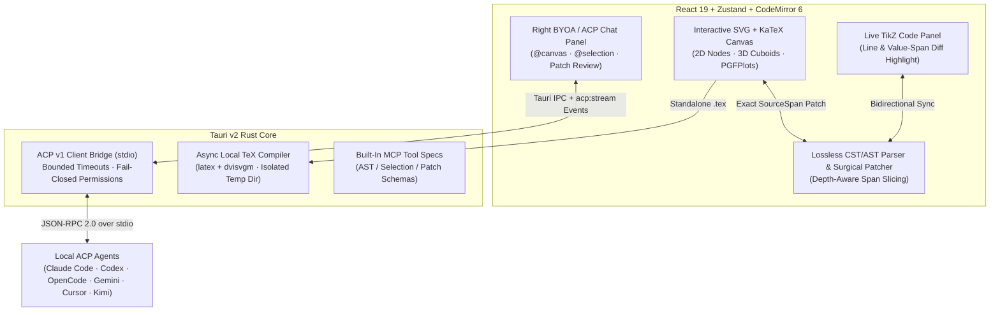

<p align="center">
  
</p>

<h1 align="center">AgenTikZ</h1>

<p align="center">
  <strong>Visual TikZ &amp; PGFPlots studio for scientific figures, powered by your own local AI agents.</strong><br>
  Lossless AST surgical patching · BYOA via ACP v1 · Venue-ready deep learning &amp; chart templates
</p>

<p align="center">
  <a href="https://github.com/jhxxr/AgenTikZ/actions/workflows/ci.yml"></a>
  <a href="https://github.com/jhxxr/AgenTikZ/actions/workflows/release.yml"></a>
  <a href="LICENSE"></a>
  <a href="package.json"></a>
  <a href="src-tauri/Cargo.toml"></a>
  <a href="src-tauri/Cargo.toml"></a>
  <a href="tsconfig.json"></a>
</p>

<p align="center">
  <strong>English</strong> · <a href="README.zh-CN.md">简体中文</a>
</p>

<p align="center">
  <a href="#key-features">Key Features</a> ·
  <a href="#architecture">Architecture</a> ·
  <a href="#publication-templates--themes">Templates &amp; Themes</a> ·
  <a href="#quick-start">Quick Start</a> ·
  <a href="#byoa-acp-setup--prompting-guide">BYOA &amp; Prompt Guide</a> ·
  <a href="#project-structure">Project Structure</a> ·
  <a href="#development--verification">Verification</a> ·
  <a href="#security--license">Security &amp; License</a>
</p>

---

**AgenTikZ** is a visual TikZ and PGFPlots editor built for machine learning researchers and scientific authors preparing figures for **NeurIPS**, **ICLR**, **ICML**, **CVPR**, and **Nature (NPG)**. It pairs an interactive vector canvas with a lossless Concrete/Abstract Syntax Tree (**CST/AST**) parser and surgical patcher—dragging a module, resizing a 3D feature volume, routing an orthogonal residual bypass, or repositioning a PGFPlots legend updates only the exact character span in your `.tex` source while preserving every user comment, `\tikzset` macro, and indentation space.

Instead of locking you into a proprietary cloud model or asking for raw API keys, AgenTikZ adopts **Bring Your Own Agent (BYOA)** over the official [Agent Client Protocol (ACP)](https://agentclientprotocol.com) (`stdio`). Connect your locally installed **Claude Code**, **Codex CLI**, **OpenCode**, **Gemini CLI**, **Cursor Agent**, or **Kimi Code** directly to the canvas, attach `@canvas` and `@selection` context, and review proposed LaTeX replacements before applying them.

## Key Features

| Lossless Source & Publication Quality | BYOA Collaboration & Scientific Workflow |
| --- | --- |
| **Surgical Span Patching**: Depth-aware CST/AST parser tracks exact `SourceSpan` offsets for coordinates, option brackets, labels, and `axis` blocks—zero formatting drift or whitespace inflation across continuous 60fps dragging. | **Native ACP v1 over `stdio`**: Built on the official Rust `agent-client-protocol` SDK. Streams live reasoning (`thought`), tool calls, and text chunks from local agent CLIs without third-party cloud relays. |
| **Venue-Calibrated Aesthetics**: Built-in color tokens, line widths, arrow tips, and typography presets tailored for **NeurIPS / ICLR**, **CVPR / ICCV**, **Nature (NPG)**, and **IEEE / ACM**. | **Review-First Patch Proposals**: Agent responses never overwrite your figure blindly. Complete `\begin{tikzpicture}...\end{tikzpicture}` blocks are extracted as pending proposals with one-click apply and revert. |
| **Deep Learning & PGFPlots Primitives**: First-class support for Pre-LN Transformer blocks, 3D feature map cuboids ($C\times H\times W$), $\oplus/\otimes$ operators, dashed stage containers, error-band scaling curves, grouped ablation bars, heatmaps, and boxplots. | **Dual-Engine Rendering & Export**: Instant interactive SVG + KaTeX canvas paired with local TeX Live (`latex` + `dvisvgm`) compilation preview and one-click export to `.tikz`, `\begin{figure}`, standalone `.tex`, `.svg`, or `.pdf`. |

## Architecture



- **Lossless CST/AST Engine**: Located in `src/core/parser/`, the parser resolves `\tikzset` style definitions, `\node` statements, orthogonal/curved/residual `\draw` edges, and `\begin{axis}...\end{axis}` PGFPlots environments using depth-aware bracket `[]` and brace `{}` matching so math expressions like `$p(x;\theta)$` never truncate statement boundaries.
- **Official ACP v1 Transport**: Located in `src-tauri/src/acp/mod.rs`, the desktop backend launches locally installed ACP adapters over `stdio` with bounded initialization (`20s`), session creation (`20s`), prompt execution (`180s`), and transport shutdown timeouts.
- **Release Scope**: Current release **v0.1.0** provides full visual editing, 6 publication templates, 4 venue themes, local TeX Live preview, and `stdio`-based ACP v1 prompt/stream integration. Interactive filesystem/command permission approval dialogs for external agents are intentionally denied by default (fail-closed).

## Publication Templates & Themes

### 6 Built-In Full-Figure Templates

| Template | Target Venue | Category | Included Components |
| --- | --- | --- | --- |
| **Pre-LN Transformer + Scaling Plot** | NeurIPS / ICLR | `transformer` | RoPE Embedding, RMSNorm, Multi-Head Self-Attention, SwiGLU FFN, symmetric orthogonal residual skips, and 3-curve error-band PGFPlots chart |
| **Parallel Q-K-V & Gated Attention** | ICLR / ICML | `transformer` | Equidistant 3-branch $\mathbf{Q}/\mathbf{K}/\mathbf{V}$ projections, $\otimes$ dot-product operators, causal softmax, and formula callouts |
| **Multi-Scale 3D Feature Pyramid (FPN)** | CVPR / ICCV | `vision_multimodal` | Hierarchical 3D feature volumes ($\mathbf{C}_2 \rightarrow \mathbf{C}_5$), spatial downsampling, top-down FPN neck, and lateral skip connections |
| **Vision-Language Contrastive Alignment** | CVPR / NeurIPS | `vision_multimodal` | Symmetric ViT + Text Transformer dual towers, centered InfoNCE loss, and cross-modal cosine similarity heatmap |
| **Latent Diffusion / Flow Matching (DiT)** | ICML / NeurIPS | `generative` | Noisy latent cuboid $\mathbf{z}_t$, spatial-temporal self-attention, top-down AdaLN-Zero $\gamma,\beta$ modulation, and Flow Matching objective |
| **Multi-Panel Experimental Dashboard** | Nature / Science | `data_charts` | NPG 0.55pt fine-axis dual panel: (a) 3-curve sample efficiency with error bands and (b) 3-group cross-domain ablation bar chart |

### 4 Journal Color & Typography Presets

- **NeurIPS / ICLR Modern** (`neurips`): Oxford blue (`nips_blue`), warm attention amber (`nips_amber`), sage residual green (`nips_sage`), latent purple (`nips_purple`), `0.7pt` lines, `-Stealth` arrows.
- **CVPR / ICCV Vision** (`cvpr`): Backbone navy (`cvpr_navy`), neck coral (`cvpr_coral`), feature teal (`cvpr_teal`), `0.75pt` lines, 3D cuboid volume presets.
- **Nature / Science Minimal** (`nature`): Canonical NPG palette (`#E64B35`, `#4DBBD5`, `#00A087`, `#3C5488`), `0.55pt` ultra-fine axes, `-Latex` arrows.
- **IEEE / ACM Monochrome-Ready** (`ieee`): High-contrast royal blue (`#00629B`) and grayscale-safe fills with crisp `1.0pt` corners.

## Quick Start

| Mode | Best For | Requirements |
| --- | --- | --- |
| **Desktop App (`tauri dev` / build)** | Full experience: Visual Canvas + Local ACP Agents + Local TeX Live compilation | **Node.js >= 20**, **Rust (stable)**, WebView2 (Windows) / webkit2gtk (Linux) |
| **Web Studio (`npm run dev`)** | Instant browser trial of the visual TikZ/PGFPlots canvas, lossless code sync, and exports | **Node.js >= 20** and npm |

### 1. Clone & Install Dependencies

```sh
git clone https://github.com/jhxxr/AgenTikZ.git
cd AgenTikZ
npm ci
```

### 2. Run in Browser Mode (Visual Canvas & Code Sync)

```sh
npm run dev
```

Open `http://localhost:1420` in your browser. You can load any of the 6 venue templates, drag nodes and 3D cuboids, edit PGFPlots data series, switch journal themes, and export `.tikz` / `.tex` / `.svg` / `.pdf`.

> **Note**: Browser mode intentionally does not connect to local `stdio` processes or generate simulated AI responses. Use the Tauri desktop app below to connect real local ACP agents.

### 3. Run the Desktop App (BYOA ACP + Local TeX Live)

```sh
npm run tauri dev
```

- **Local TeX Live Preview (Optional)**: If `latex` and `dvisvgm` (from TeX Live or MiKTeX) are on your system `PATH`, clicking **TeX** in the top toolbar compiles your standalone document asynchronously in an isolated temp directory and opens a side-by-side vector comparison view.
- **Production Desktop Bundle**:
  ```sh
  npm run tauri build
  ```

## BYOA (ACP) Setup & Prompting Guide

AgenTikZ connects to external coding agents over `stdio` using the Agent Client Protocol (`v1`). AgenTikZ never downloads packages implicitly (`npx -y` is not used) and never stores model API keys—install and authenticate the agent CLI you prefer on your machine first.

### Supported Local ACP Agents

| Agent Provider | Expected Executable on `PATH` | Default Args | Setup Notes |
| --- | --- | --- | --- |
| **Claude Code (ACP)** | `claude-agent-acp` | *(none)* | Install `@agentclientprotocol/claude-agent-acp` globally and authenticate Claude Code |
| **OpenCode (ACP)** | `opencode` | `acp` | Install OpenCode CLI (`opencode acp`) |
| **Codex CLI (ACP)** | `codex-acp` | *(none)* | Install `@zed-industries/codex-acp` globally and sign in to Codex CLI |
| **Gemini CLI (ACP)** | `gemini` | `--acp` | Install Gemini CLI with `--acp` support |
| **Cursor Agent (ACP)** | `cursor-agent` | `acp` | Install Cursor Agent CLI |
| **Kimi Code (ACP)** | `kimi` | `acp` | Install Kimi CLI with `acp` subcommand |
| **Custom ACP Agent** | User-configured executable | User-configured | Click the terminal icon in the right panel and enter `<executable> <args>` or `{"command":"...","args":[],"env":{}}` |

### Ready-to-Use Scientific Figure Prompts

Select elements on the canvas (or toggle `@canvas` and `@选中` context pills in the right panel) and paste any of the prompts below:

#### 1. Add a Cross-Attention Branch to Selected Modules

```text
Based on the currently selected nodes (@selection) and @canvas:
1. Add a parallel Cross-Modal Attention branch to the right of the selected layer (x offset +3.8cm) using the current venue theme's color tokens.
2. Connect its output back into the main stream via a centered \oplus operator node (op_circle).
3. Preserve all existing comments, \tikzset styles, and node IDs, and return the complete updated \begin{tikzpicture}...\end{tikzpicture} block.
```

#### 2. Convert an Architecture Diagram to a Joint Architecture + PGFPlots Figure

```text
Keep the existing architecture on the left side of @canvas and add a publication-grade PGFPlots \begin{axis} panel on the right (shifted to x=8.2cm):
- Chart type: line plot with error bars (+- (0, err)) comparing "Ours" vs. "Baseline" across 4 compute scales.
- Match the active journal theme palette and keep axis dimensions at width=5.8cm, height=4.5cm.
- Add aligned (a) and (b) subcaption nodes underneath both panels.
```

#### 3. Refine Layout Grid & Orthogonal Residual Routing

```text
Inspect @canvas and clean up the geometric alignment without changing any scientific labels or math formulas:
1. Snap all main-stream vertical backbone layers to a uniform 1.2cm vertical grid step.
2. Convert any diagonal skip connections into symmetric orthogonal residual bypasses (-- ++(1.1, 0) |-) with midway {\scriptsize Residual} labels.
```

## Project Structure

```text
src/
  components/
    agent/          # Right docked BYOA / ACP chat panel, stream status, and patch review cards
    canvas/         # Interactive SVG + KaTeX canvas, 3D cuboid projection, and PGFPlots renderer
    editor/         # CodeMirror 6 TikZ editor with real-time line & value-span diff banners
    inspector/      # Floating property inspector for geometry, styles, routing, and chart series
    sidebar/        # Left tabbed sidebar: topology minimap template gallery, primitives, and code
    toolbar/        # Top toolbar: tool groups, alignment helpers, theme switcher, TeX preview, exports
  core/
    parser/         # Lossless CST/AST TikZ & PGFPlots parser, surgical span patcher, and unit tests
    templates/      # 6 publication-grade full-figure templates and 13 modular primitives
    themes/         # NeurIPS, CVPR, Nature (NPG), and IEEE color tokens and preamble generators
  store/            # Zustand workspace store (undo/redo, AST sync) and ACP agent store + tests
  types/            # TypeScript contracts for TikZ AST spans, themes, and ACP streaming events
src-tauri/
  src/
    acp/            # Official ACP v1 stdio client bridge, executable resolution, and unit tests
    mcp/            # Built-in MCP tool manifest definitions for canvas AST & patch schemas
    tex/            # Async local TeX Live (latex + dvisvgm) preview compiler
```

## Development & Verification

Run the frontend unit tests, TypeScript/Vite production build, and Rust backend test suite before submitting changes:

```sh
# 1. Run Vitest unit tests (50-frame zero-whitespace-drift stress tests + ACP store contract tests)
npm test

# 2. Run TypeScript typecheck and Vite production bundle build
npm run build

# 3. Run Rust ACP & Tauri backend unit tests
cargo test --manifest-path src-tauri/Cargo.toml
```

## Security & License

- **Trust & Execution Boundary**:
  - **No Implicit Downloads**: AgenTikZ resolves ACP executables strictly from your local `PATH` (or explicit custom command path) and never invokes `npx -y` to download unverified packages behind the scenes.
  - **Isolated Working Directory**: Local ACP sessions are initialized with an isolated `app_data_dir()/agent-workspace` working directory rather than exposing your home directory or project root.
  - **Fail-Closed Permissions**: Incoming ACP `RequestPermissionRequest` calls for arbitrary filesystem writes or terminal commands are automatically denied (`RequestPermissionOutcome::Cancelled`); agents return proposed TikZ code as text for your explicit review.
  - **External Agent Privileges**: Note that an ACP agent CLI process you launch still runs under your OS user account and sends prompt context to the model provider configured in that CLI.
- **License**: Released under the [MIT License](LICENSE).
