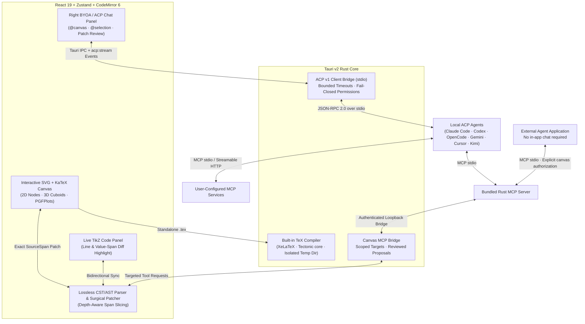

<p align="center">
  
</p>

<h1 align="center">AgenTikZ</h1>

<p align="center">
  <strong>Visual TikZ &amp; PGFPlots studio for scientific figures, powered by your own local AI agents.</strong><br>
  Lossless AST surgical patching · BYOA via ACP v1 · Dedicated paper writing &amp; scientific drawing
</p>

<p align="center">
  <a href="https://github.com/jhxxr/AgenTikZ/actions/workflows/ci.yml"></a>
  <a href="https://github.com/jhxxr/AgenTikZ/actions/workflows/release.yml"></a>
  <a href="LICENSE"></a>
  <a href="package.json"></a>
  <a href="src-tauri/Cargo.toml"></a>
  <a href="src-tauri/Cargo.toml"></a>
  <a href="tsconfig.json"></a>
</p>

<p align="center">
  <strong>English</strong> · <a href="README.zh-CN.md">简体中文</a>
</p>

<p align="center">
  <a href="#interface--workflow-tour">Screenshots</a> ·
  <a href="#key-features">Key Features</a> ·
  <a href="#architecture">Architecture</a> ·
  <a href="#paper-templates--themes">Paper Templates &amp; Themes</a> ·
  <a href="#quick-start">Quick Start</a> ·
  <a href="#byoa-acp-setup--prompting-guide">BYOA &amp; Prompt Guide</a> ·
  <a href="#project-structure">Project Structure</a> ·
  <a href="#development--verification">Verification</a> ·
  <a href="#security--license">Security &amp; License</a>
</p>

<p align="center">
  
</p>

---

**AgenTikZ** is a visual TikZ and PGFPlots editor built for machine learning researchers and scientific authors preparing figures for **NeurIPS**, **ICLR**, **ICML**, **CVPR**, and **Nature (NPG)**. It pairs an interactive vector canvas with a lossless Concrete/Abstract Syntax Tree (**CST/AST**) parser and surgical patcher—dragging a module, resizing a 3D feature volume, routing an orthogonal residual bypass, or repositioning a PGFPlots legend updates only the exact character span in your `.tex` source while preserving every user comment, `\tikzset` macro, and indentation space.

Instead of locking you into a proprietary cloud model or asking for raw API keys, AgenTikZ adopts **Bring Your Own Agent (BYOA)** over the official [Agent Client Protocol (ACP)](https://agentclientprotocol.com) (`stdio`). Connect your locally installed **Claude Code**, **Codex CLI**, **OpenCode**, **Gemini CLI**, **Cursor Agent**, or **Kimi Code** directly to the canvas, attach `@canvas` and `@selection` context, and review proposed LaTeX replacements or let automatic mode apply each valid tool edit immediately, with undo and version-conflict checks.

An optional **embedded Pi SDK backend** now shares the same project tools and proposal review workflow. Select it under **Settings → Agent**, load the pinned model catalog and store a provider API key in the OS credential store. Pi retains tool history in a long-lived process, without requiring Pi CLI. Node.js 22.19+ is still user-provided; model usage is billed by the selected provider. Pi currently exposes only AgenTikZ tools, not native shell/file tools or third-party MCP servers. Cancellation, project switches, runtime resets and restarts discard runtime history; the visible chat is replayed on recovery. See [Pi runtime notes](docs/pi-runtime.zh-CN.md).

**Image references and visual review:** paste screenshots into Agent chat, inspect removable thumbnails, or send an image without text. Pi and ACP receive actual image blocks. The `render_canvas_preview` tool returns a real TeX rendering of a pending or automatically applied figure proposal so a vision-capable agent can inspect and refine it. Manual mode requires review; automatic mode applies each valid tool edit immediately. Each request allows up to three distinct renders and caches identical inputs. The desktop app is required (built-in TeX engine, no TeX Live installation); a successful compile or layout score is not visual verification.

**Built-in scientific drawing skill:** `tikz-diagram-reproduction` guides composition, data-state shapes, semantic colors and faithful reference reproduction. Its four reference families (SWSA, multi-stream GNN, masked autoencoders, and Riemannian/temporal pipelines) are available through paged `get_diagram_design_skill` calls. Complete templates are not injected into every prompt. Reference colors/layouts are protected from automatic repair, and complex shapes/macros use exact TeX preview. See [v0.6.0 release notes](docs/releases/v0.6.0.md).

## Interface & Workflow Tour

### 1. Visual Studio, Lossless AST Code Sync & BYOA Agent Diff Review
Real-time bidirectional synchronization between the CodeMirror 6 TikZ editor (left, with surgical `SourceSpan` value highlights), the interactive SVG + KaTeX vector canvas with floating selection bar (center), and the BYOA / ACP Agent collaboration panel with semantic AST change pills, layout health scoring, and inline diff preview (right).


### 2. Drawing Primitives & 3D Feature Inspector
Start from a blank canvas and add nodes, 3D feature volumes, and PGFPlots charts using the toolbar or primitives. The full-figure template gallery and template loader remain removed. Agents can consult the built-in drawing skill's paged references for relevant visual patterns while constructing the user's actual method. Existing drawings remain editable.

### 3. Nature (NPG) Multi-Panel Scientific Charts, Project Assets & AI Cutout Generator
Manage manuscript files (`main.tex`, `sections/*.tex`), multi-canvas figures (`figures/*.tikz`), and transparent AI scientific illustrations on the left, while editing multi-panel PGFPlots error-band curves, ablation bar charts, and data series tables on the right.


### 4. Dedicated Paper Workspace: Files, Outline, Source & PDF
Writing and drawing have separate workspaces. The paper workspace includes a file tree, section outline, CodeMirror editor, and resizable PDF preview. Creating papers, opening chapters, or inserting figures never opens the drawing canvas automatically. New papers can use a blank manuscript or original IEEEtran, NeurIPS, ICML, ICLR, CVPR/ICCV and ACL/EMNLP author kits. Additional templates can be imported from folders, archives, URLs or Git repositories. PDF compilation requires the desktop app, which ships its own TeX engine; browser mode does not simulate compilation.

The divider includes source → PDF and PDF → source SyncTeX controls; `Ctrl/⌘ + click` on the PDF also returns to the corresponding source line. Desktop builds enable `-synctex=1` and require the `synctex` binary from your TeX installation. Recompile after source edits to refresh the map.

### 5. Agentero-Style BYOA (ACP v1) & 5-Point Figure Contract Settings Center
Configure local ACP agents (**Claude Code**, **OpenCode**, **Codex CLI**, **Gemini CLI**, **Cursor Agent**, **Kimi Code**) with dual-tier PATH + bundled adapter detection, one-click `stdio` handshake verification, and Nature Skills 5-Point Figure Contract enforcement.


## Key Features

| Lossless Source & Publication Quality | BYOA Collaboration & Scientific Workflow |
| --- | --- |
| **Surgical Span Patching**: Depth-aware CST/AST parser tracks exact `SourceSpan` offsets for coordinates, option brackets, labels, and `axis` blocks—zero formatting drift or whitespace inflation across continuous 60fps dragging. | **Native ACP v1 over `stdio`**: Built on the official Rust `agent-client-protocol` SDK. Streams live reasoning (`thought`), tool calls, and text chunks from local agent CLIs without third-party cloud relays. |
| **Venue-Calibrated Aesthetics**: Built-in color tokens, line widths, arrow tips, and typography presets tailored for **NeurIPS / ICLR**, **CVPR / ICCV**, **Nature (NPG)**, and **IEEE / ACM**. | **Review-First Patch Proposals**: Agent responses never overwrite your figure blindly. Complete `\begin{tikzpicture}...\end{tikzpicture}` blocks are extracted as pending proposals with one-click apply and revert. |
| **Deep Learning & PGFPlots Primitives**: First-class support for Pre-LN Transformer blocks, 3D feature map cuboids ($C\times H\times W$), $\oplus/\otimes$ operators, dashed stage containers, error-band scaling curves, grouped ablation bars, heatmaps, and boxplots. | **Dual-Engine Rendering & Export**: Instant interactive SVG + KaTeX canvas paired with the built-in XeLaTeX engine (Tectonic core + bundled Noto Sans CJK SC) compilation preview and one-click export to `.tikz`, `\begin{figure}`, standalone `.tex`, `.svg`, or `.pdf`. |

## Architecture

**External-agent control:** AgenTikZ can act as a standalone **MCP server** for another local agent application. Open **Settings → MCP 服务 → 让外部 Agent 操作 AgenTikZ**, choose read-only, reviewed edits, or direct edits, then copy the generated stdio configuration into that client. No in-app chat, ACP adapter, or model API key is needed. The connection is canvas-scoped and temporary; switching canvases or closing it revokes access. See the [MCP guide](docs/mcp-guide.zh-CN.md).



- **Lossless CST/AST Engine**: Located in `src/core/parser/`, the parser resolves `\tikzset` style definitions, `\node` statements, orthogonal/curved/residual `\draw` edges, and `\begin{axis}...\end{axis}` PGFPlots environments using depth-aware bracket `[]` and brace `{}` matching so math expressions like `$p(x;\theta)$` never truncate statement boundaries.
- **Original Canvas Compatibility**: Coordinate paths, fills, curves and rotated labels join the existing AST and share `InteractiveCanvas`, its floating toolbar, inspector, dragging, eight-way resizing, duplication, alignment and undo with regular nodes, edges and charts. Coordinate bases and physical units are normalized to the canvas's cm space; edits patch their original source. Ordinary macro calls and bounded `foreach` loops are editable groups whose instance transforms and arguments preserve shared definitions. TeX preview and export retain their existing behavior.
- **Editing and Exact Rendering**: The interactive canvas supports nodes, edges, charts, coordinate paths, labels and bounded macro groups. Arbitrary TeX programs still require source editing, with unsupported source preserved. Exact TeX preview stays beside the editor. Desktop SVG/PNG exports use the same real TeX SVG and never silently substitute an approximation after compilation or missing-glyph failures. Full documents containing CJK text receive bundled fonts in the compilation copy only when CJK fonts were not already configured; drawing commands remain unchanged.
- **Official ACP v1 Transport**: Located in `src-tauri/src/acp/mod.rs`, the desktop backend launches locally installed ACP adapters over `stdio` with bounded initialization (`20s`), session creation (`20s`), prompt execution (`180s`), and transport shutdown timeouts.
- **Release Scope**: **v0.9.2** extends the original editing canvas to coordinate paths, fills, rotated labels and bounded macro groups. Physical units, negative coordinate axes and per-instance source edits keep imported figures editable through the existing tools. The standalone stdio MCP drawing server from v0.9.0 remains available to external local agent applications, without an in-app chat or ACP session. Choose read-only, reviewed edits or direct edits; canvas/version checks, undo and real TeX previews remain in place. Existing in-app agents and the bundled TeX engine, CJK fonts and paper templates are retained. See [v0.9.2 release notes](docs/releases/v0.9.2.md).

## Paper Templates & Themes

### Paper Starters

The desktop app ships **original IEEEtran, NeurIPS 2026, ICML 2026, ICLR 2027, CVPR/ICCV and ACL/EMNLP author kits**, preserving their styles, examples, bibliography and figures instead of imitating a venue with generic `article` layouts. A minimal blank manuscript remains available. Nature's figure palette is retained, but it is no longer presented as an official paper template.

Use **New paper → Import template** to add a local folder, `.zip` / `.tar.gz` / `.tar` archive, archive download URL (including extensionless endpoints), or HTTPS Git repository. GitHub, GitLab and Gitee use archive downloads; other Git hosts require a local `git` executable. You can specify a repository subtree and choose the main file when several documents are found. Imported templates live in the app data directory and can be reused across projects; deleting a template does not delete papers already created from it.

Importing only downloads/copies and inspects source files: **it does not compile them or run repository scripts by default**. Once you trust the source, choose *Trial build* or explicitly enable a trial after import to check bundled-engine compatibility and inspect real diagnostics. The main file and template-specific folders (such as `sec/`) are remembered in the project. Official sample titles and authors are unchanged; edit them in the main document.

These official kits generally target pdfLaTeX. They have been tested to produce PDFs with the bundled XeTeX core, but final submissions should be checked with the venue's required toolchain. ECCV 2026 is not bundled because its `axessibility` dependency is incompatible with this engine. See [`runtime/paper-templates/SOURCES.md`](runtime/paper-templates/SOURCES.md) for provenance and licenses. Remote imports currently support public HTTP(S) sources, not SSH or private-repository login. For branch names containing `/`, use an explicit archive download URL.

### 4 Journal Color & Typography Presets

- **NeurIPS / ICLR Modern** (`neurips`): Oxford blue (`nips_blue`), warm attention amber (`nips_amber`), sage residual green (`nips_sage`), latent purple (`nips_purple`), `0.7pt` lines, `-Stealth` arrows.
- **CVPR / ICCV Vision** (`cvpr`): Backbone navy (`cvpr_navy`), neck coral (`cvpr_coral`), feature teal (`cvpr_teal`), `0.75pt` lines, 3D cuboid volume presets.
- **Nature / Science Minimal** (`nature`): Canonical NPG palette (`#E64B35`, `#4DBBD5`, `#00A087`, `#3C5488`), `0.55pt` ultra-fine axes, `-Latex` arrows.
- **IEEE / ACM Monochrome-Ready** (`ieee`): High-contrast royal blue (`#00629B`) and grayscale-safe fills with crisp `1.0pt` corners.

## Quick Start

| Mode | Best For | Requirements |
| --- | --- | --- |
| **Desktop App (`tauri dev` / build)** | Full experience: Visual Canvas + Embedded Pi / Local ACP Agents + Built-in TeX compilation | **Node.js >= 22.19.0**, **Rust (stable)**, WebView2 (Windows) / webkit2gtk (Linux) |
| **Web Studio (`npm run dev`)** | Instant browser trial of the visual TikZ/PGFPlots canvas, lossless code sync, and exports | **Node.js >= 22.19.0** and npm |

### 1. Clone & Install Dependencies

```sh
git clone https://github.com/jhxxr/AgenTikZ.git
cd AgenTikZ
npm ci
```

### 2. Run in Browser Mode (Visual Canvas & Code Sync)

```sh
npm run dev
```

Open `http://localhost:1420` in your browser. You can edit paper sources, start a blank drawing, drag nodes and 3D cuboids, edit PGFPlots data series, switch journal themes, and export `.tikz` / `.tex` / `.svg` / `.pdf`.

> **Note**: Browser mode intentionally does not connect to local `stdio` processes or generate simulated AI responses. Use the Tauri desktop app below to connect real local ACP agents.

### 3. Run the Desktop App (BYOA ACP + Built-in TeX Engine)

```sh
npm run tauri dev
```

- **Built-in TeX engine (zero install)**: the app ships Tectonic (XeTeX core) and Noto Sans CJK SC. TeX Live, MiKTeX and MacTeX are **not** required and the system `PATH` is not consulted. The arrow next to a compile button switches engines and offers *force rebuild*, *clean and rebuild* and *remove build files*. TikZ figures are compiled to path-only SVG (all glyphs outlined, so no installed font is needed) and papers compile to PDF with a SyncTeX map.
- **Packages**: TikZ, PGFPlots, tikz-3dplot, pgf-blur, xcolor, standalone, geometry, preview, varwidth, amsmath, mathtools, amssymb, bm, fontspec and xeCJK are pre-installed for offline use; other packages download once on first use and are cached locally. Very large figures (tens of thousands of cells or thousands of nodes) can hit the engine's fixed memory limit — prefer PGFPlots `matrix plot` or split subfigures.
- **Production Desktop Bundle**:
  ```sh
  npm run tauri build
  ```

### Desktop package layout

The application remains a native Rust/Tauri executable. npm/Vite are build tools, not a development environment shipped to users. esbuild combines the Claude/Codex ACP adapters into standalone `.mjs` files. Only those bundles, their manifest, the Linux browser-launch helper, and third-party notices are packaged—not a full `node_modules` tree, type declarations, or source maps.

```text
adapters/
├── manifest.json
├── THIRD_PARTY_NOTICES.txt
├── claude-code/index.mjs
└── codex-cli/
    ├── index.mjs
    └── xdg-open
```

This reduces adapter resources; it does **not** embed a Node runtime. The bundled adapters still require local Node.js (22+ required for Claude, 22+ recommended for both) and an installed, authenticated Claude Code or Codex CLI. A standalone ACP adapter on PATH takes precedence. Otherwise, the desktop launcher uses the bundled adapter and supplies `CLAUDE_CODE_EXECUTABLE` / `CODEX_PATH` pointing to the user's CLI. Non-AI editing, rendering, and export do not depend on these adapters.

```sh
npm run adapters:stage           # Install pinned adapters, bundle, verify; automatic during builds
npm run adapters:stage -- --force
npm run adapters:verify          # Relocated version + ACP initialize tests; no model calls
npm run test:packaging           # Cache, resource, size-limit, and rollback tests
```

The manifest records a build fingerprint and per-file SHA-256 hashes. Corrupt resources or changed build scripts invalidate the cache. Bundles are verified in an isolated location without user credentials before replacing existing resources. Adapter upgrades must review dynamic assets and third-party terms, not simply remove files absent from static imports.

After a successful Windows NSIS reinstall/update, the installer recognizes and removes the legacy packaged `adapters/node_modules` tree, without deleting user projects, configuration, or globally installed CLIs.

## BYOA (ACP) Setup & Prompting Guide

AgenTikZ connects to external coding agents over `stdio` using the Agent Client Protocol (`v1`). AgenTikZ never downloads packages implicitly at runtime (`npx -y` is not used) and never stores model API keys—install and authenticate your preferred agent CLI first. Claude/Codex can use the bundled adapters; other agents must provide ACP support locally.

### Supported Local ACP Agents

| Agent Provider | Expected Executable on `PATH` | Default Args | Setup Notes |
| --- | --- | --- | --- |
| **Claude Code (ACP)** | `claude-agent-acp`, or `claude` + `node` | *(none)* | Standalone ACP adapter takes precedence; otherwise use the bundled adapter with Node.js 22+ and authenticate Claude Code |
| **OpenCode (ACP)** | `opencode` | `acp` | Install OpenCode CLI (`opencode acp`) |
| **Codex CLI (ACP)** | `codex-acp`, or `codex` + `node` | *(none)* | Standalone ACP adapter takes precedence; otherwise use the bundled adapter with Node.js (22+ recommended) and authenticate Codex CLI |
| **Gemini CLI (ACP)** | `gemini` | `--acp` | Install Gemini CLI with `--acp` support |
| **Cursor Agent (ACP)** | `cursor-agent` | `acp` | Install Cursor Agent CLI |
| **Kimi Code (ACP)** | `kimi` | `acp` | Install Kimi CLI with `acp` subcommand |
| **Custom ACP Agent** | User-configured executable | User-configured | Click the terminal icon in the right panel and enter `<executable> <args>` or `{"command":"...","args":[],"env":{}}` |

**Model selection:** connect to an ACP agent to load its advertised model options, then select a model in settings or chat. Each prompt session applies and verifies that selection before sending context. Embedded Pi supports multiple independent channels with custom base URLs/API protocols, OS-keychain credentials, fetched or manually added/deleted models, and quick channel/model switching in chat. See [Pi configuration](docs/pi-runtime.zh-CN.md) and [ACP model selection / gateway troubleshooting](docs/mcp-guide.zh-CN.md#acp-连接与模型选择).

### Ready-to-Use Scientific Figure Prompts

Select elements on the canvas (or toggle `@canvas` and `@选中` context pills in the right panel) and paste any of the prompts below:

#### 1. Add a Cross-Attention Branch to Selected Modules

```text
Based on the currently selected nodes (@selection) and @canvas:
1. Add a parallel Cross-Modal Attention branch to the right of the selected layer (x offset +3.8cm) using the current venue theme's color tokens.
2. Connect its output back into the main stream via a centered \oplus operator node (op_circle).
3. Preserve all existing comments, \tikzset styles, and node IDs, and return the complete updated \begin{tikzpicture}...\end{tikzpicture} block.
```

#### 2. Convert an Architecture Diagram to a Joint Architecture + PGFPlots Figure

```text
Keep the existing architecture on the left side of @canvas and add a publication-grade PGFPlots \begin{axis} panel on the right (shifted to x=8.2cm):
- Chart type: line plot with error bars (+- (0, err)) comparing "Ours" vs. "Baseline" across 4 compute scales.
- Match the active journal theme palette and keep axis dimensions at width=5.8cm, height=4.5cm.
- Add aligned (a) and (b) subcaption nodes underneath both panels.
```

#### 3. Refine Layout Grid & Orthogonal Residual Routing

```text
Inspect @canvas and clean up the geometric alignment without changing any scientific labels or math formulas:
1. Snap all main-stream vertical backbone layers to a uniform 1.2cm vertical grid step.
2. Convert any diagonal skip connections into symmetric orthogonal residual bypasses (-- ++(1.1, 0) |-) with midway {\scriptsize Residual} labels.
```

## Project Structure

```text
src/
  components/
    agent/          # Right docked BYOA / ACP chat panel, stream status, and patch review cards
    canvas/         # Interactive SVG + KaTeX canvas, 3D cuboid projection, and PGFPlots renderer
    editor/         # CodeMirror 6 TikZ editor with real-time line & value-span diff banners
    inspector/      # Floating property inspector for geometry, styles, routing, and chart series
    sidebar/        # Drawing sidebar: project assets, primitives, and code
    toolbar/        # Top toolbar: tool groups, alignment helpers, theme switcher, TeX preview, exports
  core/
    parser/         # Lossless CST/AST TikZ & PGFPlots parser, surgical span patcher, and unit tests
    tikz/           # Modular drawing and chart primitives
    paper/          # Paper starters and figure-insertion LaTeX utilities
    themes/         # NeurIPS, CVPR, Nature (NPG), and IEEE color tokens and preamble generators
  store/            # Zustand workspace store (undo/redo, AST sync) and ACP agent store + tests
  types/            # TypeScript contracts for TikZ AST spans, themes, and ACP streaming events
src-tauri/
  src/
    acp/            # Official ACP v1 stdio client bridge, executable resolution, and unit tests
    mcp/            # MCP configuration, credentials, authenticated bridge and canvas tool routing
    tex/            # Built-in TeX runtime: engine resolution, package cache, PDF/SVG builds
```

## Development & Verification

Run the frontend unit tests, TypeScript/Vite production build, and Rust backend test suite before submitting changes:

```sh
# 1. Run Vitest unit tests (50-frame zero-whitespace-drift stress tests + ACP store contract tests)
npm test

# 2. Run TypeScript typecheck and Vite production bundle build
npm run build

# 3. Run Rust ACP & Tauri backend unit tests
npm run mcp:stage
npm run test:mcp
cargo test --manifest-path src-tauri/Cargo.toml
```

## Security & License

- **Trust & Execution Boundary**:
  - **No Implicit Downloads**: AgenTikZ resolves ACP executables strictly from your local `PATH` (or explicit custom command path) and never invokes `npx -y` to download unverified packages behind the scenes.
  - **Configurable Local Access**: **Settings → Agent → 完整本机访问 (Full local access)** is off by default. Enabling it allows the agent to read and modify files outside the project and execute its native commands. This preference is saved locally and takes effect on the next message, including in an existing chat.
  - **Working Directory**: Restricted sessions use `app_data_dir()/agent-workspace`. With full access enabled, the working directory follows the current project, or a folder selected in Agent settings; without either, it uses the application workspace. Relative or missing custom directories produce an actionable error. A working directory is not an OS sandbox.
  - **Tool Permissions**: Restricted sessions cancel native filesystem/command permission requests; explicitly enabled MCP tools are authorized independently. Full access selects the agent's advertised full-access mode when available and enables ACP text-file read/write capabilities. Permission responses select `allow_once`; requests offering only persistent permission are cancelled. Native CLI tools retain their own capabilities and OS permissions. Canvas proposals still require clicking Apply.
  - **MCP Server**: **Settings → MCP 服务** exposes 11 drawing tools to independent local agent clients via stdio, with read-only, review, or direct-edit authorization. Edits bind to the shared canvas and source revision and use the existing undo/save workflow. The copied connection configuration contains a temporary token; only share it with trusted clients. In-app agents retain 4 additional project tools. Third-party MCP service management remains under Advanced. See the [MCP guide](docs/mcp-guide.zh-CN.md).
  - **External Agent Privileges**: Note that an ACP agent CLI process you launch still runs under your OS user account and sends prompt context to the model provider configured in that CLI.
- **License**: Released under the [MIT License](LICENSE).
