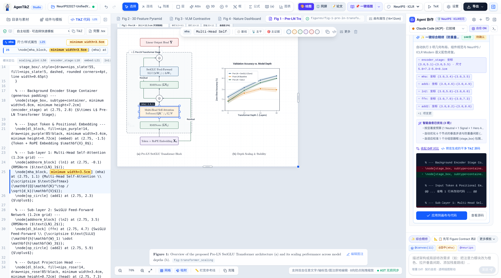
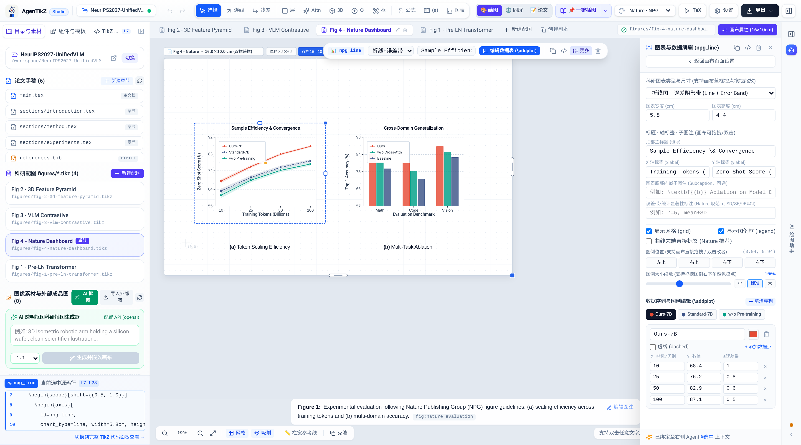
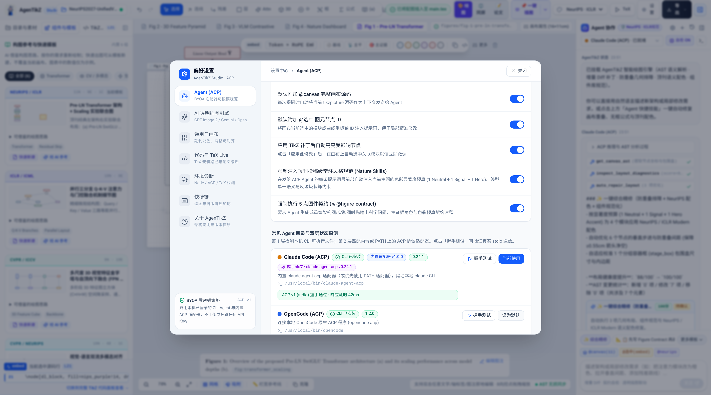
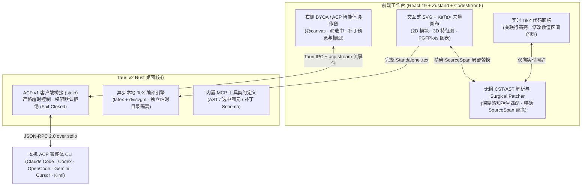

<p align="center">
  
</p>

<h1 align="center">AgenTikZ</h1>

<p align="center">
  <strong>面向科研论文与深度学习顶会的 AI 原生 TikZ &amp; PGFPlots 可视化工作室。</strong><br>
  无损 AST 外科手术级代码同步 · 原生 BYOA (ACP v1) 本地智能体协同 · 独立论文写作与科研配色规范
</p>

<p align="center">
  <a href="https://github.com/jhxxr/AgenTikZ/actions/workflows/ci.yml"></a>
  <a href="https://github.com/jhxxr/AgenTikZ/actions/workflows/release.yml"></a>
  <a href="LICENSE"></a>
  <a href="package.json"></a>
  <a href="src-tauri/Cargo.toml"></a>
  <a href="src-tauri/Cargo.toml"></a>
  <a href="tsconfig.json"></a>
</p>

<p align="center">
  <a href="README.md">English</a> · <strong>简体中文</strong>
</p>

<p align="center">
  <a href="#界面与核心工作流预览">界面预览</a> ·
  <a href="#核心特性">核心特性</a> ·
  <a href="#工作原理与架构">工作原理</a> ·
  <a href="#论文模板与学术主题">论文模板与主题</a> ·
  <a href="#快速开始">快速开始</a> ·
  <a href="#byoa-智能体接入与提示词指南">BYOA 与提示词指南</a> ·
  <a href="#项目结构">项目结构</a> ·
  <a href="#开发与验证">开发与验证</a> ·
  <a href="#安全边界与许可证">安全与许可证</a>
</p>

<p align="center">
  
</p>

---

**AgenTikZ** 是一款专为机器学习与自然科学研究者打造的 **TikZ 与 PGFPlots 可视化编辑器**，面向 **NeurIPS**、**ICLR**、**ICML**、**CVPR** 与 **Nature (NPG)** 论文插图标准设计。系统底层采用基于字符级源码跨度（`SourceSpan`）的 **无损 CST/AST 解析器与外科手术式补丁引擎（Surgical Patcher）**——在画布上拖拽网络层、调整 3D 特征图（$C\times H\times W$）通道厚度、拉动正交残差跳线或移动 PGFPlots 图例时，仅精准替换 `.tex` 源码中对应的数值区间，100% 保留手写注释、`\tikzset` 宏定义与原有缩进格式。

在 AI 协同方面，AgenTikZ 采用 **自带智能体（BYOA, Bring Your Own Agent）** 架构，基于官方 [Agent Client Protocol (ACP)](https://agentclientprotocol.com)（`stdio`）直接连接你本机已安装并登录的 **Claude Code**、**Codex CLI**、**OpenCode**、**Gemini CLI**、**Cursor Agent** 或 **Kimi Code**。无需在软件内配置模型 API Key，无需经过第三方云端中继；支持一键附加 `@canvas` 与 `@选中` 图元上下文，所有 AI 生成的 TikZ 代码均需人工预览确认后才会应用到画布。

**图片参考与视觉复核**：Agent 输入框支持 Ctrl+V 粘贴截图、缩略图预览与移除，也可仅发送图片。Pi 和 ACP 接收原生图片块；`render_canvas_preview` 可返回待审配图的真实 TeX 渲染，让支持视觉的 Agent 看图后修正。每轮最多 3 次不同输入的渲染，相同输入复用结果，最终仍由用户审核。需要本地 TeX Live、dvisvgm 和支持图片的模型；布局评分或编译成功不等于完成视觉检查。

**内置论文绘图 skill**：`tikz-diagram-reproduction` 先规划构图分层、数据形态、语义配色与箭头语法，再生成代码。四组论文参考（SWSA、多流 GNN、掩码自编码器、黎曼/时序流程）通过 `get_diagram_design_skill` 按需分页读取，不逐轮注入整套模板。复刻图保护原有颜色与布局，复杂形状和宏使用真实 TeX 预览。详见 [v0.6.0 发布说明](docs/releases/v0.6.0.md)。

## 界面与核心工作流预览

### 1. 可视化工作室全景：无损 AST 源码同步与 BYOA 智能体增量 Diff 审阅
左侧 CodeMirror 6 编辑器实时高亮选中图元对应的源码行与精确修改区间（`minimum width=3.5cm`），中间交互式 SVG + KaTeX 矢量画布支持多配图标签页与浮动属性快捷栏，右侧 BYOA / ACP 智能体面板展示 AST 推理过程、语义变更标签、几何健康度评分（`100分`）与内联 Diff 对比预览。


### 2. 基础绘图组件与 3D 特征张量检查器
绘图从空白画布开始，可通过工具栏或基础组件添加节点、3D 特征立方体和 PGFPlots 图表。整图模板库与模板切换保持移除；Agent 可按需读取内置绘图 skill 的参考片段，学习视觉表达后构建用户实际的方法。已有绘图文件仍可正常打开和编辑。

### 3. Nature (NPG) 多面板科研实验图表、项目目录管理与 AI 透明抠图生成器
左侧统一管理论文手稿（`main.tex`、`sections/*.tex`）、科研配图（`figures/*.tikz`）与 AI 透明抠图科研插图生成器；中间画布呈现符合 **Nature (NPG)** 规范的双联实验图（误差带收敛折线图 + 跨领域消融柱状图），右侧面板支持交互式编辑 `\addplot` 数据序列、误差棒与图例布局。



### 4. 独立论文工作区：文件、大纲、源码与 PDF
论文与绘图使用独立入口。论文区提供文件树、大纲导航、CodeMirror 源码编辑器与可调整宽度的 PDF 预览；新建论文、切换章节和插入配图均不会自动打开绘图画布。新建论文保留空白、Nature、NeurIPS、CVPR、IEEE 与 arXiv 写作起点。浏览器模式不执行本地 TeX 编译；生成 PDF 需要桌面端与 TeX Live。

分隔线中提供源码 → PDF、PDF → 源码双向定位，也支持 `Ctrl/⌘ + 点击 PDF` 返回对应源码行。桌面端编译启用 `-synctex=1`，需要 TeX 安装目录内的 `synctex` 可执行文件；修改源码后须重新编译以更新映射。

绘图与论文共用右侧**项目 Agent**，切换工作区不丢失对话。论文模式支持读取当前编辑器内容（含未保存修改）、提交多文件 Diff 修改集、审核后整组应用/撤回，以及读取真实编译诊断。桌面端可“应用并编译”，PDF 预览与 Agent 共用编译状态。可选择 **内置 Pi SDK** 使用长驻会话，也可继续使用 BYOA/ACP。配图已提供有次数限制的渲染与视觉复核；整篇论文的草稿编译沙盒与自动修复循环尚未接入。详见 [MCP 服务指南](docs/mcp-guide.zh-CN.md#论文协作与审阅) 与 [Pi 接入说明](docs/pi-runtime.zh-CN.md)。

素材卡片明确区分“加入画布”和“插入论文”。插图窗口支持选图、直接导入 PDF/PNG/JPEG、逐章节插入、唯一标签与重复插入检查；手填图注不会因更换素材或刷新而被清空，保存失败不会提示成功。详见 [图片与论文插入流程](docs/figure-insertion.zh-CN.md)。

### 5. Agentero 风格 BYOA (ACP v1) 与顶刊 5 点图件契约设置中心
支持本机 `PATH` 与内置适配器双层探测（**Claude Code**、**OpenCode**、**Codex CLI**、**Gemini CLI**、**Cursor Agent**、**Kimi Code**），提供一键 `stdio` 握手延时测试，并可开启 **Nature Skills 常驻风格规范**与 **5 点图件契约（`% @figure-contract`）**。



## 核心特性

| 无损源码级精修与顶刊审美 | 原生 BYOA 智能体协同与科研工作流 |
| --- | --- |
| **外科手术级 AST 双向同步**：深度感知括号/花括号解析器精准定位每个节点坐标、样式参数、文本标签与 `axis` 图表区间，连续拖拽 50+ 帧零空格膨胀、零注释丢失。 | **官方 ACP v1 协议直连（`stdio`）**：Rust 后端集成官方 `agent-client-protocol` SDK，实时流式展示本地 Agent 的推理过程（`thought`）、工具状态与回复文本。 |
| **四大顶会/顶刊视觉规范**：内置 **NeurIPS / ICLR**、**CVPR / ICCV**、**Nature (NPG)** 与 **IEEE / ACM** 专属色板、线宽（`0.55pt`–`0.75pt`）、箭头样式与字体规范。 | **先审阅后应用的补丁机制**：Agent 返回的完整 `\begin{tikzpicture}...\end{tikzpicture}` 代码自动提取为待确认卡片，支持源码折叠预览、一键应用与随时撤回。 |
| **深度学习与 PGFPlots 原生图元**：内置 Pre-LN 注意力块、3D 特征立方体、$\oplus/\otimes$ 算子、虚线 Stage 容器，以及带误差带折线图、消融分组柱状图、热力图与箱线图。 | **双引擎渲染与全格式导出**：内置 60fps 交互式 SVG + KaTeX 矢量画布，支持调用本机 TeX Live（`latex` + `dvisvgm`）分屏对比编译，一键导出 `.tikz`、`figure` 环境、Standalone `.tex`、`.svg` 与 `.pdf`。 |

## 工作原理与架构



- **无损 CST/AST 解析引擎**：位于 `src/core/parser/`，通过深度感知括号 `[]` 与花括号 `{}` 匹配解析 `\tikzset` 样式、`\node` 节点、正交/弧线/残差 `\draw` 连线以及 `\begin{axis}...\end{axis}` 实验图表，确保含分号的数学公式（如 `$p(x;\theta)$`）或含括号文本绝不误截断语句。
- **官方 ACP v1 通信实现**：位于 `src-tauri/src/acp/mod.rs`，桌面端通过 `stdio` 启动本地已安装的 ACP 适配器，对初始化握手（`20s`）、会话创建（`20s`）、提示词生成（`180s`）及子进程退出均设有严格超时边界。
- **当前版本边界**：当前版本 **v0.7.5** 默认开启项目助手「自动模式」：本轮成功结束后自动应用最终画布或论文提案，保留版本冲突检查与撤回，并为 ACP 放行本机文件读写和命令权限。侧边栏同时收拢对话历史、模型选择、技能与可审核差异。Pi 仍仅使用 AgenTikZ 内置工具。详见 [v0.7.5 发布说明](docs/releases/v0.7.5.md)、[MCP 服务指南](docs/mcp-guide.zh-CN.md) 和 [Pi 接入说明](docs/pi-runtime.zh-CN.md)。

## 论文模板与学术主题

### 论文模板

保留空白论文、Nature、NeurIPS、CVPR、IEEE 和 arXiv 写作起点，仅生成文档与章节，不插入示例绘图或虚构实验数据。这些通用 article 起点并非期刊/会议官方投稿样式；投稿前请使用对应官方样式。

### 4 套学术期刊配色与排版预设

- **NeurIPS / ICLR Modern** (`neurips`)：牛津科研蓝（`nips_blue`）、暖杏注意力橙（`nips_amber`）、鼠尾草残差绿（`nips_sage`）、潜空间紫（`nips_purple`），`0.7pt` 细线与 `2.5pt` 圆角。
- **CVPR / ICCV Vision** (`cvpr`)：Backbone 深蓝（`cvpr_navy`）、Neck 珊瑚橙（`cvpr_coral`）、Feature 青绿（`cvpr_teal`），`0.75pt` 线宽，专为多尺度 3D 特征体积优化。
- **Nature / Science Minimal** (`nature`)：NPG 经典高对比度色板（`#E64B35`、`#4DBBD5`、`#00A087`、`#3C5488`），`0.55pt` 纤细轴线与 `-Latex` 箭头。
- **IEEE / ACM Monochrome-Ready** (`ieee`)：兼顾彩色电子版与黑白印刷灰度层次的皇家蓝（`#00629B`）与工程灰阶预设。

## 快速开始

| 运行模式 | 适用场景 | 环境要求 |
| --- | --- | --- |
| **Tauri 桌面应用 (`tauri dev` / build)** | 完整功能体验：可视化画布 + 内置 Pi / 本地 ACP 智能体 + 本机 TeX Live 编译对比 | **Node.js >= 22.19.0**、**Rust (stable)**、WebView2 (Windows) / webkit2gtk (Linux) |
| **Web 浏览器模式 (`npm run dev`)** | 快速体验可视化 TikZ/PGFPlots 画布、双向无损源码同步与多格式插图导出 | **Node.js >= 22.19.0** 与 npm |

### 1. 克隆仓库并安装依赖

```sh
git clone https://github.com/jhxxr/AgenTikZ.git
cd AgenTikZ
npm ci
```

### 2. 启动 Web 浏览器模式（画布与源码同步）

```sh
npm run dev
```

浏览器打开 `http://localhost:1420` 即可使用独立论文编辑区、基础绘图与 PGFPlots 组件、实时代码行高亮对比以及 `.tikz` / `.tex` / `.svg` / `.pdf` 导出。

> **说明**：纯浏览器环境无法直接调用本机 `stdio` 子进程，且 AgenTikZ 坚持**不生成假冒模拟回复**。如需连接本地 ACP 智能体或调用本机 TeX Live 编译，请使用下方的 Tauri 桌面模式。

### 3. 启动 Tauri 桌面应用（支持本地 ACP 智能体与 TeX Live）

```sh
npm run tauri dev
```

- **本机 TeX Live 矢量编译对比（可选）**：若本机 `PATH` 中已安装 `latex` 与 `dvisvgm`（来自 TeX Live 或 MiKTeX），点击顶部工具栏的 **TeX** 按钮即可在独立临时目录中异步编译完整文档，并开启左右分屏对比预览。
- **复杂 TikZ 图形预览**：常用的 `\newcommand` / `\def` 宏、坐标表达式、矩形、圆、贝塞尔曲线、旋转文字及作用域裁剪可使用 SVG 兼容预览。遇到这类图形会自动尝试 TeX 精确编译；失败时保留真实诊断并明确标注兼容预览。超出兼容语法范围的图形仍需本机 TeX。
- **完整文档导入**：粘贴含 `\documentclass` 的完整 LaTeX 时，保留原有导言区、字体和页面设置；自动恢复旧版导出造成的重复文档包装。
- **构建桌面端安装包**：
  ```sh
  npm run tauri build
  ```

### 桌面安装包结构

应用主体仍是 Rust/Tauri 原生程序；构建时使用的 npm/Vite 不会作为完整开发环境安装到用户电脑。Claude/Codex ACP 适配器由 esbuild 合并为两个独立的 `.mjs`，只随包附带清单、Linux 浏览器启动辅助脚本及第三方许可证，不再复制整棵 `node_modules`、类型声明或 source map。

```text
adapters/
├── manifest.json
├── THIRD_PARTY_NOTICES.txt
├── claude-code/index.mjs
└── codex-cli/
    ├── index.mjs
    └── xdg-open
```

这是**精简适配器资源**，不是内置 Node 运行时：使用内置适配器仍需本机 Node.js（Claude 适配器要求 22+，建议统一使用 22+），以及已安装、已登录的 Claude Code 或 Codex CLI。桌面端优先使用 PATH 中的独立 ACP 适配器，否则使用内置适配器，并通过 `CLAUDE_CODE_EXECUTABLE` / `CODEX_PATH` 指向用户自己的 CLI。无需 AI 的编辑、渲染、导出不依赖这些适配器。

```sh
npm run adapters:stage           # 安装固定版本依赖、合并并校验；构建时自动执行
npm run adapters:stage -- --force
npm run adapters:verify          # 在隔离目录检查版本与 ACP initialize，不调用模型
npm run test:packaging           # 缓存、资源、体积限制与失败回滚测试
```

生成清单记录构建指纹和各文件的 SHA-256；缓存资源损坏或构建脚本改变会触发重建。打包前自动验证移位后的适配器，不使用用户登录信息；验证成功后才替换旧资源。升级适配器时需复查动态资源及第三方条款，不能仅删除未被静态导入的文件。

Windows NSIS 安装包在覆盖安装成功后，会识别并清理旧版随包安装的 `adapters/node_modules`，不删除用户项目、配置或本机全局 CLI。

## BYOA 智能体接入与提示词指南

AgenTikZ 的 BYOA 模式通过标准输入输出（`stdio`）使用 ACP v1 协议与本机安装的智能体 CLI 通信。**运行时不会隐式下载外部程序（不使用 `npx -y`），ACP 模式复用 CLI 登录**——请先在本机安装并登录对应 CLI；Claude/Codex 可使用内置适配器，其他智能体需自行提供 ACP 支持。独立的内置 Pi 后端在设置中选择 provider、模型并保存 API Key；密钥进入系统凭据库，不写入前端设置，模型服务单独计费。

### 支持的本地 ACP 智能体列表

| 智能体选项 | 本机 `PATH` 需存在的可执行文件 | 默认启动参数 | 安装与配置说明 |
| --- | --- | --- | --- |
| **Claude Code (ACP)** | `claude-agent-acp`，或 `claude` + `node` | *(无)* | 独立 ACP 适配器优先；也可用内置适配器 + Node.js 22+，需完成 Claude CLI 登录 |
| **OpenCode (ACP)** | `opencode` | `acp` | 安装 OpenCode CLI（支持 `opencode acp` 子命令） |
| **Codex CLI (ACP)** | `codex-acp`，或 `codex` + `node` | *(无)* | 独立 ACP 适配器优先；也可用内置适配器 + Node.js（建议 22+），需完成 Codex CLI 登录 |
| **Gemini CLI (ACP)** | `gemini` | `--acp` | 安装支持 `--acp` 参数的 Gemini CLI |
| **Cursor Agent (ACP)** | `cursor-agent` | `acp` | 安装支持 `acp` 子命令的 Cursor Agent CLI |
| **Kimi Code (ACP)** | `kimi` | `acp` | 安装支持 `acp` 子命令的 Kimi CLI |
| **自定义 ACP Agent** | 用户自定义路径与命令 | 用户自定义 | 点击右侧面板终端图标，输入可执行文件与参数或 JSON 配置 `{"command":"...","args":[],"env":{}}` |

**模型选择**：点击“连接 / 获取模型”，可在设置或聊天面板选择 ACP Agent 实际提供的模型；每轮建立会话后确认模型切换成功再发送提示词。内置 Pi 支持多个独立渠道、自定义 URL/API 协议、系统凭据库 Key、获取/手动添加/删除模型，以及聊天面板快速切换。详见 [Pi 配置](docs/pi-runtime.zh-CN.md) 与 [ACP 模型选择和网关排错](docs/mcp-guide.zh-CN.md#acp-连接与模型选择)。

### 常用科研绘图提示词模板（可直接复制）

在画布上框选目标模块（并在右侧面板开启 `@canvas` 与 `@选中` 上下文标签），即可复制以下提示词发送给本地 ACP 智能体：

#### 1. 为选中网络层添加跨模态注意力分支

```text
请基于当前画布 (@canvas) 与我选中的模块 (@selection)：
1. 在选中模块右侧（水平偏移 +3.8cm）添加一个并行的 Cross-Modal Attention 分支，配色遵循当前顶会主题的色板宏。
2. 在主干流上方添加一个居中的 \oplus 算子圆节点（op_circle），将跨模态分支输出汇入主干。
3. 严格保留原有的所有注释、\tikzset 样式定义与节点 ID，返回完整可替换的 \begin{tikzpicture}...\end{tikzpicture} 代码块。
```

#### 2. 构建“左模型架构 + 右实验曲线”顶会 Figure 1 联合图

```text
请保留当前 @canvas 左侧的模型架构不变，在右侧（shift={(8.2, 2.5)}）新增一个符合 NeurIPS 规范的 PGFPlots \begin{axis} 实验对比图：
- 图表类型：带标准差误差棒 (+- (0, err)) 的折线图，对比 Ours 与 Baseline 在 4 个训练规模下的准确率。
- 尺寸设为 width=5.8cm, height=4.5cm，并在左、右两个面板正下方添加对齐的 (a) 与 (b) 子图图注节点。
```

#### 3. 规范化网格间距与正交残差跳线

```text
请检查当前 @canvas 的几何排版，在不改变任何数学公式与模块语义的前提下进行排版精修：
1. 将纵向主干上的所有模块按 1.2cm 垂直网格步进严格对齐。
2. 将跨层跳跃连接统一规范为左右对称的正交残差跳线（-- ++(1.1, 0) |-），并在跳线中段添加白底 {\scriptsize Residual} 标签。
```

## 项目结构

```text
src/
  components/
    agent/          # 右侧 BYOA / ACP 智能体协作面板、流式状态展示与代码补丁审阅卡片
    canvas/         # 交互式 SVG + KaTeX 矢量画布、3D 特征图投影与 PGFPlots 图表渲染器
    editor/         # CodeMirror 6 TikZ 代码编辑器、关联行高亮与修改数值区间实时闪烁横幅
    inspector/      # 浮动属性检查器（几何坐标、顶刊色板、残差跳线跨度、PGFPlots 数据表编辑）
    sidebar/        # 绘图区：项目素材、基础组件与代码面板
    toolbar/        # 顶部工具栏：分组绘图工具、多选对齐、期刊主题切换、TeX 编译预览与多格式导出
  core/
    parser/         # 无损 CST/AST TikZ & PGFPlots 解析器、外科手术式 Span 补丁引擎及单元测试
    tikz/           # 基础绘图与科研图表组件定义
    paper/          # 论文写作起点与插图 LaTeX 工具
    themes/         # NeurIPS、CVPR、Nature (NPG) 与 IEEE 色彩 Token 及 LaTeX 导言区生成器
  store/            # Zustand 画布状态管理（Undo/Redo、AST 同步）与 ACP 智能体状态管理及测试
  types/            # TikZ AST 源码跨度、主题规范与 ACP 流式事件 TypeScript 类型定义
src-tauri/
  src/
    acp/            # 官方 ACP v1 stdio 客户端桥接、PATH 可执行文件解析与 Rust 单元测试
    mcp/            # 内置 MCP 画布工具契约定义（AST 查询、选中元素与补丁 Schema）
    tex/            # 异步本地 TeX Live (latex + dvisvgm) 独立临时目录编译模块
```

## 开发与验证

提交代码或打包发布前，请运行完整的前端单元测试、TypeScript/Vite 生产构建以及 Rust 后端测试套件：

```sh
# 1. 运行 Vitest 单元测试（含连续 50 帧拖拽零空格膨胀压力测试 + ACP 状态契约测试）
npm test

# 2. 运行 TypeScript 类型检查与 Vite 生产环境打包验证
npm run build

# 3. 运行 Rust Tauri / ACP 后端单元测试
cargo test --manifest-path src-tauri/Cargo.toml
```

## 安全边界与许可证

- **执行与信任边界说明**：
  - **拒绝隐式下载**：AgenTikZ 仅从本机 `PATH`（或你在自定义面板中显式配置的路径）查找并启动 ACP 可执行文件，绝不在后台调用 `npx -y` 隐式下载未验证的远程包。
  - **独立工作目录隔离**：ACP 会话启动时使用独立的 `app_data_dir()/agent-workspace` 空工作目录，不会将你的个人主目录或无关代码仓库暴露为 Agent 的项目根目录。
  - **权限请求默认拒绝（Fail-Closed）**：当前客户端不包含高危操作审批弹窗，Agent 发起的任何文件读写或终端命令权限请求（`RequestPermissionRequest`）均会被自动拒绝（`Cancelled`），仅允许 Agent 以纯文本代码提案形式返回修改建议。
  - **外部 CLI 权限提示**：请注意，由你安装并启动的本地 ACP Agent 进程仍运行在你的操作系统用户权限下，且你附加的画布上下文会发送给该 Agent CLI 所配置的模型服务商。
- **开源许可证**：项目源码采用 [MIT License](LICENSE) 授权。
